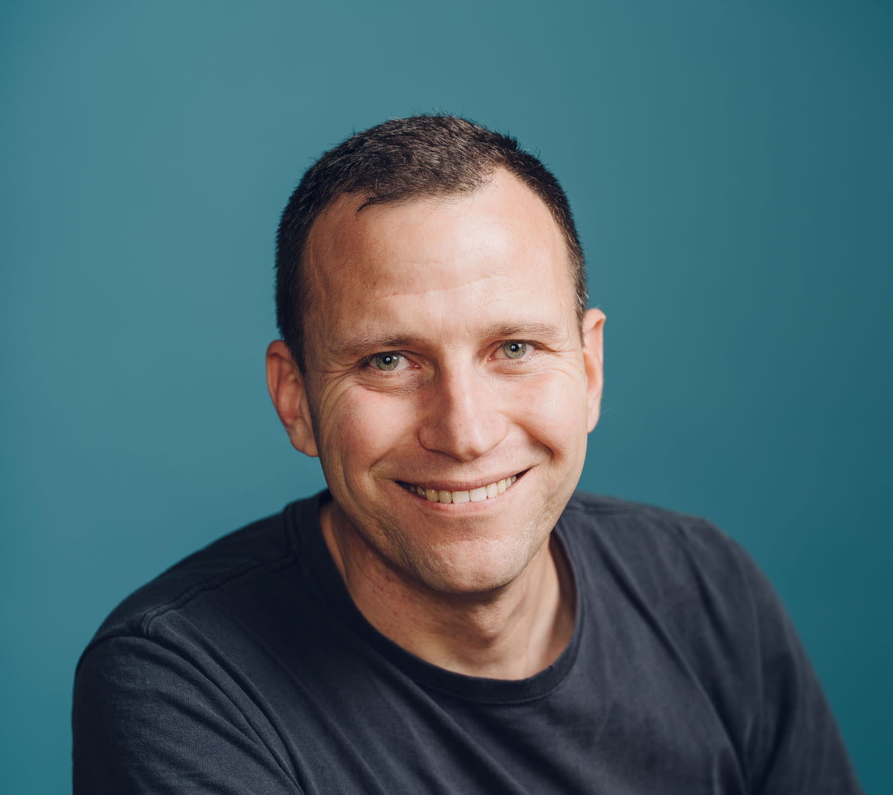

Product Builder · Agents & Automation
-------------------------------------
**25 years turning complex enterprise systems into products people use.**

Engineering, product, and design. Startups, unicorns, Fortune 500. Now: building agents that do real work on real systems.

> **Hands-on, not just strategy.** I build and run my own multi-agent system in production, and I take the same architecture into enterprise products.

Bio
---
Bay Area-based, with U.S., Israeli, and EU citizenship.

Started as an engineer at [Intel (NASDAQ: INTC)](https://www.intel.com). Co-founded [eDealya](https://www.crunchbase.com/organization/edealya) and took it from zero to product (raised $1M from [Nielsen's incubator](https://www.nielsen.com), acqui-hired). Led product design at [Gainsight](https://www.gainsight.com) (PE-held unicorn, 25+ team), where I built LLM-based DesignOps tooling. At [SugarCRM](https://www.sugarcrm.com), I drove the shift from reactive system of record to proactive system of guidance: self-healing data via LLMs and agentic AI for precision selling.

Earlier: product and engineering teams at [Amdocs (NASDAQ: DOX)](https://www.amdocs.com), delivering for clients like [AT&T](https://www.att.com). Product roles at [Totango](https://www.totango.com), [Degreed](https://www.degreed.com), [Grovo](https://www.grovo.com) and [ZaiNar](https://www.zainar.com). Officer in an elite Israeli military unit, with training equivalent to West Point, completed with honors.

Shipped at Scale
----------------

- **eDealya:** Co-founded, built from zero, raised $1M from Nielsen incubator, **acqui-hired**.
- **Gainsight:** Scaled product design org to 25+. LLM-based DesignOps that automated UX audits and design standards. [Moscone 5K+ people keynote](https://www.youtube.com/watch?v=WYp0qn1kThg).
- **ZaiNar:** ML pipeline for real-time 3D indoor location. Robotic test automation ([registered U.S. patent](https://patents.google.com/patent/US11785482B1/en)).
- **Degreed:** Shipped recommender + skill-graph used by Fortune 500 L&D orgs.
- **SugarCRM:** Drove FY27 reposition for a 700-person org, from system of record → system of guidance.

Currently Building
------------------
**Multi-Agent System · In Production · 6+ months · Ships Nightly**

- Always-on agent system on edge hardware at home, with Claude Code as the orchestration layer.
- Coding agents dispatch and review their own GitHub work. The system catches its own failures and self-heals.
- Agents act through real surfaces: email, calendar, chat, a desk display, a physical keypad and a small voice robot.

Same "system of guidance" architecture I took into SugarCRM's FY27 strategy, tested on myself first.

**Hands-on:** LLM APIs and agent frameworks (Claude Code, multi-agent orchestration, tool integrations), GitHub automation, ML pipelines, edge hardware, a Solana smart contract.

Looking For
-----------
Field roles where the goal is bringing agentic systems into production for enterprise customers: **manufacturing, healthcare, finance, logistics**. Not generic AI features. Living-organism orchestration, embedded with the customer, shipped in their environment.

Timeline
--------
What I built, who it shipped to, what changed.

- **Aug 2025 - Present:** _VP Product Strategy & AI_, [SugarCRM](https://www.sugarcrm.com), Remote · 700-person org
  Drove FY27 reposition: system of record → system of guidance. Self-healing data via LLMs, agentic AI for precision selling. Lead AI and ERP-native selling product direction with engineering.
- **Mar 2025 - Aug 2025:** _Consultant_, Foldspace, Sunnyvale, USA
  AI product strategy and agent orchestration advisory.
- **May 2021 - Mar 2025:** _Head of Product Design_, [Gainsight](https://www.gainsight.com), San Francisco, USA
  Scaled product design org to 25+ at PE-held unicorn. Built an LLM-based DesignOps system that automated UX audits, enforced design standards and generated artifacts. [Moscone 5K+ people keynote](https://www.youtube.com/watch?v=WYp0qn1kThg).
- **Mar 2020 - May 2021:** _Technical Product Manager_, [ZaiNar](https://www.zainar.com), Silicon Valley, USA
  RF + edge hardware product with sub-nanosecond timing. ML pipeline for real-time 3D indoor location. Robotic indoor location testing ([registered U.S. patent](https://patents.google.com/patent/US11785482B1/en)).
- **Mar 2018 - Mar 2020:** _Director of Product_, [Degreed](https://www.degreed.com), San Francisco, USA
  Owned core learning experience for the enterprise upskilling platform. Shipped recommender + skill-graph surfaces used by Fortune 500 L&D orgs.
- **Jan 2017 - Mar 2018:** _Senior Product Manager_, [Grovo](https://www.grovo.com), New York, USA
  Rebuilt authoring tooling so SMB teams could ship custom training without a course-design team.
- **Aug 2013 - Jan 2017:** _Senior Product Manager (Mobile)_, [Totango](https://www.totango.com), Silicon Valley, USA
  Built first-generation mobile customer-success surfaces and early signal-driven workflows.
- **Jan 2011 - Aug 2013:** _Co-founder & SVP Product_, [eDealya](https://www.crunchbase.com/organization/edealya), Tel Aviv → Silicon Valley
  Co-founded ad-tech orchestration company and built it from zero. Raised $1M from Nielsen incubator. Acqui-hired.
- **Oct 2005 - Jan 2011:** _Product Management & Web Solutions_, [Amdocs (NASDAQ: DOX)](https://www.amdocs.com), Tel Aviv, Israel
  Carrier-grade web and product solutions for Tier-1 telcos including [AT&T](https://www.att.com).
- **Aug 2002 - Oct 2005:** _Yield Analysis Engineer_, [Intel Corporation (NASDAQ: INTC)](https://www.intel.com), Israel
  Silicon yield analysis at fab scale.
- **1996 - 1999:** _Officer (Special Unit)_, Israel Defense Forces, Israel
  Officer training equivalent to West Point, completed with honors.

Education & Recognition
-----------------------
- B.Sc. Information Technology Engineering, _Magna Cum Laude_
- MBA · [Ben-Gurion University](https://in.bgu.ac.il/en/)
- Specialized entrepreneurial program · [Merage School of Business, UC Irvine](https://merage.uci.edu)
- [U.S. patent US11785482B1](https://patents.google.com/patent/US11785482B1/en), robotic indoor location testing

Contact
-------
- [ophirsw@gmail.com](mailto:ophirsw@gmail.com)
- [LinkedIn /in/ophirsw](https://www.linkedin.com/in/ophirsw)
- [GitHub @ophir-sw](https://github.com/ophir-sw)
- Based: San Francisco Bay Area
